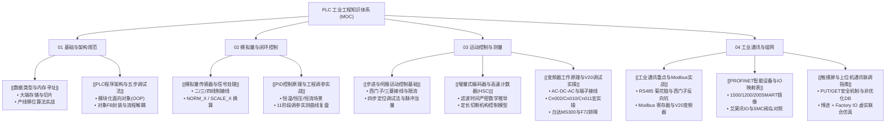

# 🏭 PLC 工程知识库全局导航 (MOC)

> [!abstract] 欢迎来到 PLC 工业自动化工程知识库
> 本知识库系统化提炼自一线工程实操文档、参数记录与实操经验，涵盖从底层电气接线、内存寻址、模拟量转换，到运动控制定位、高速脉冲测量，再到工业总线与上位联调的完整工业控制知识体系。

---

## 🗺️ 知识体系架构全景图



---

## 📚 知识模块索引目录

### 模块一：基础与架构规范（01_基础与规范）
- [[数据类型与内存寻址]]
  - *核心要点*：西门子大端字节序（`DBD0` $\to$ `DBW0`/`DBW2` $\to$ `DBB0`~`DBB3` $\to$ `DBX0.0`~`DBX3.7`）；位切片访问语法（`%X0`~`%X15`）；流水灯/三色警示灯 3 位二进制左移与颜色码补入算法。
- [[PLC程序架构与五步调试法]]
  - *核心要点*：工业级程序架构；被控对象抽象为独立 FB 单体自测；主流程 FC 与状态 DB 解耦设计；五步法调试交付规范。

---

### 模块二：模拟量与闭环控制（02_模拟量与控制）
- [[模拟量传感器与信号处理]]
  - *核心要点*：数字量 vs 模拟量；RTD/热电偶/压力/流量/液位传感器工作原理；二/三/四线制接线接法；信号隔离与配电器；S7 通道标准 `0~27648` 对应关系；`NORM_X` 与 `SCALE_X` 标定。
- [[PID控制原理与工程调参实战]]
  - *核心要点*：过程控制核心；P/I/D 参数物理意义；采样周期规范；实测 **11 阶段调参响应曲线演进复盘**（从 $P=100$ 发散振荡，到 $P=2$ 纯比例静差，再到 $P=3, I=34$ 完美收敛）；工程调参口诀。

---

### 模块三：运动控制与测量（03_运动控制与测量）
- [[步进与伺服运动控制基础]]
  - *核心要点*：位置/速度/扭矩三模式；步进驱动器峰值/均值电流设定防烧规程；西门子共阴极（PNP） vs 三菱共阳极（NPN）接线差异；差分 5V 光耦串接 $2\,\text{k}\Omega$ 限流电阻；导程/螺距/圈脉冲/脉冲当量几何计算；四步定位调试法。
- [[增量式编码器与高速计数器(HSC)]]
  - *核心要点*：定长控制、测速与辨向；输入滤波时间严格数学推导（避免漏脉冲）；输送带滚轴直径与皮带厚度补偿几何模型；TIA Portal 组态与 `CTRL_HSC` 控制逻辑。
- [[变频器工作原理与V20调试实操]]
  - *核心要点*：变频调速与交-直-交拓扑；V20 主回路与控制端子布置（DIC公共端 PNP/NPN）；出厂复位与电机铭牌参数录入；三大连接宏深度实战（Cn002 端子控制、Cn010 USS 总线、Cn011 Modbus RTU）；彻底根除 F72 超时报警秘籍（P2014=0 + P0971=1）；台达 MS300 参数组与 Modbus Hex 地址映射。

---

### 模块四：工业通讯与组网（04_工业通讯与组网）
- [[工业通讯重点与Modbus实战]]
  - *核心要点*：通讯三要素（协议、角色、链路）；Modbus RTU 菊花链布线、单端屏蔽与 $120\,\Omega$ 终端电阻；**西门子 RS485 引脚反向坑（B+, A-）**；Modbus 4 大寄存器寻址映射；V20 变频器控制字写入；Modbus TCP 与 PROFINET 基础。
- [[PROFINET智能设备与IO映射表]]
  - *核心要点*：PROFINET I-Device 镜像映射规则；S7-1500 Controller 与 S7-1200 / S7-200 SMART 的输入输出交叉对应表；艾莫讯远程 IO 模块 DI/DO/AI/AO 通道地址表；SMC EX260/EX245 总线气动阀岛控制字分配表。
- [[触摸屏与上位机通讯联调指南]]
  - *核心要点*：同网段不同 IP 规划与 PING 诊断；博途 CPU 必须勾选“允许 PUT/GET 通信访问”与下载硬件组态；DB 块取消“优化的块访问”；MCGS 通讯驱动参数；PG/PC 接口设置；博途与 Factory I/O 3D 虚拟产线联合仿真。

---

## ⚡ 现场工程避坑速查表

| 领域 / 模块 | 致命陷阱 | 正确处理与规避准则 |
| :--- | :--- | :--- |
| **内存寻址** | 变量地址重叠（如用了 `MW0` 又分配 `MW1`） | 字变量间隔 2 字节（`MW0`, `MW2`），双字间隔 4 字节（`MD0`, `MD4`）。 |
| **模拟量** | 4~20mA 误配成 0~20mA 导致无法断线检测 | 组态选 `4..20mA`（对应 `0~27648`）；若选 `0..20mA`，4mA 对应为 `5530`，为 0 时提示断线。 |
| **PID整定** | 在 OB1 主循环中直接执行 PID 运算 | PID 计算必须放置在**周期性循环中断（如 OB30 / OB35）**中，保证采样周期恒定。 |
| **步进电机** | 驱动器拨码电流设得高于电机铭牌 | 设定电流必须 $\le$ 电机铭牌额定电流，严防静态或运转时发热烧坏内部线圈。 |
| **驱动器光耦** | PLC 24V 输出直连 5V 差分驱动器端子 | **必须串联 $2\,\text{k}\Omega$ 限流电阻**，否则将直接击穿驱动器内部光耦！ |
| **高速计数器** | 脉冲计数严重丢失，实际尺寸走长 | 输入通道滤波时间设得过大！必须根据电机最高转速严密计算，选择 $\le 0.2\,\text{ms}$。 |
| **变频器通信** | V20 接入 Modbus RTU 频繁报 F72 停机 | 默认监控超时 `P2014=100ms` 太短，**必须设 `P2014=0` 并执行 `P0971=1`** 永久存入 EEPROM。 |
| **RS485通信** | 西门子与第三方仪表 A/B 直连通讯失败 | 西门子内部定义反向：**西门子 B 接第三方正(+)，西门子 A 接第三方负(-)**。 |
| **HMI触摸屏** | 网线通但画面全带问号/无法读写数据 | 1. 博途 CPU 勾选“允许来自远程对象的 PUT/GET 访问”并**下载硬件组态**；<br>2. 目标 DB 块取消勾选“优化的块访问”。 |

---

## 🛠️ 模板工具与资源
- [[模板_PLC学习笔记|新建笔记模板：模板_PLC学习笔记]]
- 附件资源库：[attachments](file:///E:/Obsidian/1/PLC/attachments)（存储了 21 张高清架构、工程实测曲线与接线截图）
- 原始文档备份：[文档](file:///E:/Obsidian/1/PLC/文档)（保存了原始 Word 与 Excel 文件）

```dataview
TABLE category AS "分类", status AS "状态", file.mtime AS "最后修改时间"
FROM "PLC"
WHERE file.name != "00_PLC知识库导航 (MOC)" AND file.name != "模板_PLC学习笔记"
SORT file.name ASC
```
