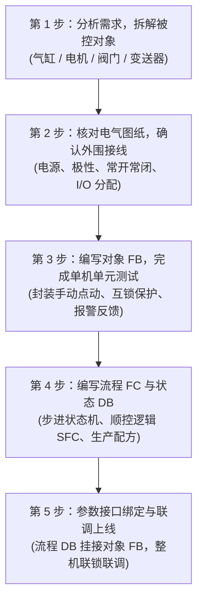

# PLC 程序架构与五步调试法

> [!abstract] 核心概览
> 工业控制系统中最忌讳“面条式”乱序编程。现代 PLC 软件工程推崇**面向对象的模块化设计思想**：将被控机构抽象为独立的功能块（FB），将业务逻辑与流程状态集中于组织块（FC）和数据块（DB）。通过科学的“五步法”，能够实现单机自测、软硬件解耦与快速现场交付。

---

## 1. 五步工程法工作流



---

## 2. 五步调试法深度详解

### 第 1 步：了解控制要求，分析出被控对象
- **核心目的**：理清“谁在动作”、“谁在反馈”。
- **实施操作**：
  - 研读工艺说明书，提取机械动作元器件（如：提升气缸、旋转电机、推料伺服、注塑加热阀）。
  - 明确每个机构的传感器配置（原位磁簧开关、到位开关、压力开关、超程光电）。
  - 制定明确的**动作互锁边界**（例如：推料气缸未退回时，升降机构严禁下行）。

### 第 2 步：画图与外围接线确认
- **核心目的**：消除硬件隐患，确保“信号能进能出”。
- **实施操作**：
  - 确认供电回路：DC 24V 开关电源极性，接地端（PE）可靠连接。
  - 确认传感器类型：输入公共端为 PNP（源型，接 24V）还是 NPN（漏型，接 0V）。
  - 确认安全回路：急停按钮、安全门必须使用**常闭触点（NC）**接入硬件安全继电器或安全输入。
  - 使用万用表与现场打点，逐一核对实际接线端子与 PLC I/O 变量表的一致性。

### 第 3 步：建立对象 FB 并进行单体测试
- **核心目的**：面向对象封装，实现标准设备组件复用。
- **实施操作**：
  - 为每一类设备编写标准化 FB（如 `FB_Cylinder`、`FB_Motor`、`FB_VFD`）。
  - **接口定义规范**：
    - `Input`：手动按钮、急停信号、传感器原位/到位反馈、超时报警阈值。
    - `Output`：电磁阀输出、接触器吸合、故障指示。
    - `InOut`：配方参数、运行累计统计。
  - **单机测试**：在不启动整体自动流程的情况下，在监控表或触摸屏手动画面中逐个测试每个 FB 的动作与报警，确保单体功能 100% 正常。

### 第 4 步：建立 FC 与 DB，编写流程控制程序
- **核心目的**：构建系统状态机与工艺流水线逻辑。
- **实施操作**：
  - 采用**状态机设计（State Machine / Case 结构）**或步进控制（Step Control）。
  - 创建专用的流程数据块（如 `DB_Sequence`），存储当前步骤号（`CurrentStep`）、步等待时间、工单信息。
  - 保证流程代码只关心“工序流转顺序”，不直接操作底层物理输出点。

### 第 5 步：流程 DB 连接到对象 FB 参数接口
- **核心目的**：实现顶层流程与底层驱动的最终集成。
- **实施操作**：
  - 在流程调度块中，将 `DB_Sequence` 计算出的动作请求传递给对应的设备 `FB`。
  - 采集各个 `FB` 的完成标志位（如 `Cylinder_AtWork`、`Motor_Ready`）作为流程跳转到下一步的使能条件。
  - 进行空载单循环运行 $\to$ 连续单机运行 $\to$ 带料整线联调。

---

## 3. 标准化程序架构图

```text
CPU 执行周期 (OB1)
├── 01_系统与诊断 (FC_SystemDiagnose)
├── 02_输入信号滤波与防抖 (FC_InputFilter)
├── 03_手动与单机模式 (FC_ManualControl)
│   ├── FB_Cylinder_Push (DB_Cylinder_Push)
│   └── FB_Motor_Feed (DB_Motor_Feed)
├── 04_自动流程控制 (FC_AutoSequence)
│   └── 读取 DB_Sequence 状态机
├── 05_报警与安全联锁 (FC_AlarmHandler)
└── 06_输出映射与物理驱动 (FC_OutputMapping)
```

> [!tip] 架构优势
> 1. **代码复用率高**：气缸或电机 FB 测试一次合格后，整厂项目直接复制调用。
> 2. **故障定位极速**：现场报警能精确到具体的设备 FB 实例，排障时间缩短 80%。
> 3. **安全可靠**：底层 FB 自带超时报警与防撞互锁，顶层即使逻辑编写失误也不会引发撞机事故。

---

## 4. 相关笔记与跳转

- [[00_PLC知识库导航 (MOC)|返回知识库导航]]
- [[数据类型与内存寻址|上一篇：数据类型与内存寻址]]
- [[步进与伺服运动控制基础|关联：运动控制调试方法]]
- [[触摸屏与上位机通讯联调指南|关联：上位机与现场联调]]
