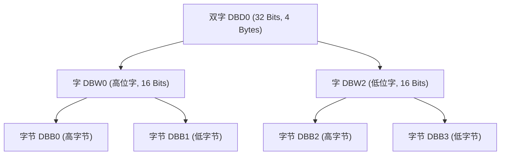

# 数据类型与内存寻址

> [!abstract] 核心概览
> PLC 编程的根基在于对内存结构与数据类型的深刻理解。西门子 S7 系列采用**大端字节序（Big-Endian）**存储，掌握位（Bit）、字节（Byte）、字（Word）、双字（DWord）的包含层级与切片访问技术，是编写高效数据流处理、流水灯移位和通信数据打包的关键。

---

## 1. 西门子 S7 内存寻址与字节序结构

西门子数据存储遵循 **高位字节存放在低地址（Big-Endian）** 的规则：



### 1.1 寻址对应关系总表

| 双字 (DWord) | 字 (Word) | 字节 (Byte) | 位 (Bit 映射: 7 $\to$ 0) | 说明 |
| :--- | :--- | :--- | :--- | :--- |
| **`DB1.DBD0`** | **`DB1.DBW0`** | **`DB1.DBB0`** | `DBX0.7` ~ `DBX0.0` | 最高字节（MSB） |
| | | **`DB1.DBB1`** | `DBX1.7` ~ `DBX1.0` | 次高字节 |
| | **`DB1.DBW2`** | **`DB1.DBB2`** | `DBX2.7` ~ `DBX2.0` | 次低字节 |
| | | **`DB1.DBB3`** | `DBX3.7` ~ `DBX3.0` | 最低字节（LSB） |

> [!warning] 经典踩坑：重叠寻址风险
> - 修改 `DB1.DBD0` 会同时覆盖 `DBW0`、`DBW2` 以及 `DBB0` ~ `DBB3`。
> - 在地址规划时，如果分配了 `MW0`（包含 `MB0`、`MB1`），下一个字变量**必须从 `MW2` 开始**，绝不能分配给 `MW1`，否则会引发严重的数据交叉污染！

---

## 2. 位切片访问（Bit Slicing）

在 TIA Portal（博途）中，对于 Word 或 DWord 变量，支持直接通过 `%X` 语法提取其中的某一位，无需复杂的掩码与运算：

例如：定义变量 `"A".灯数据` 为一个 16 位 `Word`：

| 位索引 | 对应物理输出 / 逻辑功能 | 说明 |
| :--- | :--- | :--- |
| `%X0` ~ `%X2` | 红1 / 绿1 / 蓝1 | 第 1 组三色灯 RGB |
| `%X3` ~ `%X5` | 红2 / 绿2 / 蓝2 | 第 2 组三色灯 RGB |
| `%X6` ~ `%X8` | 红3 / 绿3 / 蓝3 | 第 3 组三色灯 RGB |
| `%X9` ~ `%X11` | 红4 / 绿4 / 蓝4 | 第 4 组三色灯 RGB |
| `%X12` ~ `%X15` | 保留高位 | 系统保留 |

---

## 3. 实战案例：流水线多色灯移位控制算法

在产线流水控制或物料跟踪中，常需对不同工位的颜色指示进行**队列移位与入队**操作。

### 3.1 编码规则表

三色灯（RGB）通过 3 位二进制编码组合出 7 种状态：

| 编码数值（十进制） | 二进制编码 | 补入颜色 | 对应逻辑说明 |
| :---: | :---: | :---: | :--- |
| **+1** | `001` | **红色 (Red)** | 仅红灯亮 |
| **+2** | `010` | **绿色 (Green)** | 仅绿灯亮 |
| **+3** | `011` | **黄色 (Yellow)** | 红 + 绿 混色 |
| **+4** | `100` | **蓝色 (Blue)** | 仅蓝灯亮 |
| **+5** | `101` | **粉色 (Magenta)** | 蓝 + 红 混色 |
| **+6** | `110` | **青色 (Cyan)** | 绿 + 蓝 混色 |
| **+7** | `111` | **白色 (White)** | 红 + 绿 + 蓝 全亮 |

### 3.2 移位控制过程演进

控制逻辑每次执行两步：
1. **左移三位（SHL 3 Bits）**：原工位的颜色状态推入下一工位（1 $\to$ 2 $\to$ 3 $\to$ 4）。
2. **补入新颜色（+ Code）**：在最低 3 位写入新进入工位物料的颜色代码。

| 步骤 / 计数值 | 动作 | `%X11` ~ `%X9` (工位4) | `%X8` ~ `%X6` (工位3) | `%X5` ~ `%X3` (工位2) | `%X2` ~ `%X0` (工位1) | 状态描述 |
| :--- | :--- | :---: | :---: | :---: | :---: | :--- |
| **初始状态** | 进红色 | `0 0 0` | `0 0 0` | `0 0 0` | `0 0 1` | 工位1亮红灯 |
| **计数 = 1** | 左移3位 | `0 0 0` | `0 0 0` | `0 0 1` | `0 0 0` | 状态向高位推进 |
| | 补红色+1 | `0 0 0` | `0 0 0` | `0 0 1` | `0 0 1` | 工位1、2均为红色 |
| **计数 = 2** | 左移3位 | `0 0 0` | `0 0 1` | `0 0 1` | `0 0 0` | 状态继续向高位推 |
| | 补红色+1 | `0 0 0` | `0 0 1` | `0 0 1` | `0 0 1` | 工位1、2、3均为红色 |
| **计数 = 3** | 左移3位 | `0 0 1` | `0 0 1` | `0 0 1` | `0 0 0` | 红灯到达工位4 |
| | 补红色+1 | `0 0 1` | `0 0 1` | `0 0 1` | `0 0 1` | 4个工位全红 |
| **计数 = 4** | 左移3位 | `0 0 1` | `0 0 1` | `0 0 1` | `0 0 0` | 工位4溢出移出 |
| | 补绿色+2 | `0 0 1` | `0 0 1` | `0 0 1` | `0 1 0` | 工位1变绿，2~4为红 |

### 3.3 SCL 核心实现代码

```scl
// 移位触发脉冲：工位检测到新工件到达
IF #TrigPulse THEN
    // 1. 将现有流水状态整体左移 3 位（空出最低 3 位用于存放新工件状态）
    #LampRegister := SHL(IN := #LampRegister, N := 3);
    
    // 2. 根据新工件的颜色类型，补入对应的颜色编码（1~7）
    #LampRegister := #LampRegister OR (#NewColorCode AND 16#0007);
END_IF;

// 3. 将寄存器各位直接映射输出到物理输出点
"Q8.0" := #LampRegister.%X0;  // 红1
"Q8.1" := #LampRegister.%X1;  // 绿1
"Q8.2" := #LampRegister.%X2;  // 蓝1

"Q8.3" := #LampRegister.%X3;  // 红2
"Q8.4" := #LampRegister.%X4;  // 绿2
"Q8.5" := #LampRegister.%X5;  // 蓝2
```

---

## 4. 相关笔记与跳转

- [[00_PLC知识库导航 (MOC)|返回知识库导航]]
- [[PLC程序架构与五步调试法|下一篇：PLC程序架构与五步调试法]]
- [[模拟量传感器与信号处理|关联：模拟量传感器与转换标定]]
