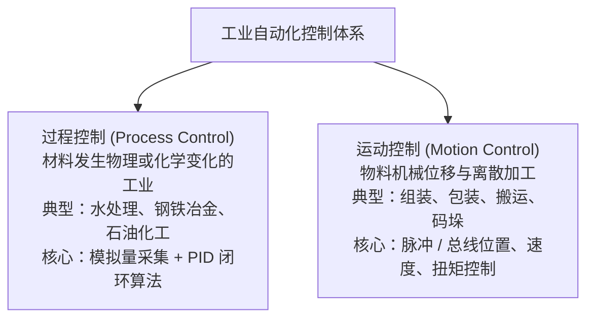
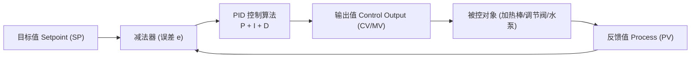

# PID 控制原理与工程调参实战

> [!abstract] 核心概览
> PID 控制是过程工业中实现“恒定控制”（恒温、恒压、恒流、恒液位、恒速）的核心算法。本章结合工业现场控制场景，深度剖析 PID 各参数的物理本质，并完整复盘从剧烈振荡到最佳响应的 **11 阶段实际调参响应曲线演进**，掌握一线工程调参精髓。

---

## 1. 行业分类与控制范畴

在工业自动化领域，控制任务主要划分为两大类：

### 1.1 什么是恒控制（PID）
- **核心目标**：使被控物理量克服外界扰动，稳定保持在设定目标值附近。
- **典型应用**：
  - **恒温控制**：工业反应釜、回流焊炉、热风循环烘箱。
  - **恒压控制**：变频恒压供水系统、气压管网稳压。
  - **恒流控制**：精密加药泵流量、管道水处理。
  - **恒液位控制**：汽包水位、缓冲水箱。
  - **恒速控制**：收卷/放卷恒线速度张力控制。
- **关联术语**：**P&ID（Piping and Instrumentation Diagram）**，即工艺管道及仪表流程图，是过程控制工程设计的标准蓝图。

---

## 2. PID 核心参数与物理意义

### 2.1 调节参数剖析
1. **P（Proportional，比例增益）**：
   - **作用**：成比例放大当前误差。$P$ 越大，反应越灵敏，动作越快。
   - **副作用**：$P$ 过大会导致系统剧烈振荡甚至发散；单独使用纯比例控制必然存在**稳态静差（残余偏差）**。
2. **I（Integral Time，积分时间，单位通常为秒）**：
   - **作用**：只要存在误差就持续累积，专门用于**彻底消除稳态静差**。
   - **注意**：积分时间 $I$ 的数值与积分作用强度成反比。**$I$ 越小，积分作用越强（累加越猛烈）；$I$ 越大，积分作用越弱**。$I$ 过小会导致超调过大并引发系统振荡。
3. **D（Derivative Time，微分时间）**：
   - **作用**：根据误差的变化趋势（变化率）提前实施阻尼制动，具有“超前预判”作用。
   - **注意**：对高频噪声极为敏感，温度或液位等纯滞后、大惯性系统常用 PI 控制，慎用微分 $D$。
4. **采样时间（Sampling Time）**：
   - 算法执行周期。必须固定且严格周期性调用（通常在循环中断 OB35 / OB30 中调用），不可在扫描周期不固定的主程序 OB1 中直接计算。

### 2.2 控制三大变量
- **目标值（SP，Setpoint）**：工艺期望达到的设定值（如 $60.0^\circ\text{C}$、$0.5\,\text{MPa}$）。
- **反馈值（PV，Process Variable）**：由现场变送器采集回来的实际物理量。
- **输出值（CV / MV，Control / Manipulated Variable）**：由 PID 块计算后送给执行机构的开度（`0.0 ~ 100.0%` 或模拟量输出 `0 ~ 27648`）。

---

## 3. 11 阶段工程实操调参全景复盘

> [!important] 调试准备
> 调试必须按顺序推进：**外围接线核对 $\to$ 硬件组态与量程确认 $\to$ 编写程序并在循环中断中调用 PID 块**。

以下记录了实际调参过程中，从最初的剧烈振荡到最终平稳收敛的完整曲线实测演变：

### 阶段一：纯比例控制阶段（寻找稳定界限）
此时将积分时间放至极大（$I = 999\text{s}$，相当于切除积分），观察不同比例 $P$ 的系统响应：

#### 1. $P = 100,\quad I = 999$
![[PID_01_P100_I999.jpg]]
- **曲线分析**：$P$ 值过大，输出剧烈打满，反馈曲线呈现大幅度发散/剧烈振荡，系统失控。

#### 2. $P = 50,\quad I = 999$
![[PID_02_P50_I999.jpg]]
- **曲线分析**：振荡幅度较 $P=100$ 有所缩小，但依然存在严重等幅超调，系统处于临界振荡边缘。

#### 3. $P = 10,\quad I = 999$
![[PID_03_P10_I999.jpg]]
- **曲线分析**：振幅大幅衰减，系统开始呈现阻尼衰减震荡趋势，但波动仍过大。

#### 4. $P = 5,\quad I = 999$
![[PID_04_P5_I999.jpg]]
- **曲线分析**：振荡周期明显拉长，超调显著降低，逐渐逼近稳定临界点。

#### 5. $P = 2,\quad I = 999$
![[PID_05_P2_I999.jpg]]
- **曲线分析**：曲线非常平稳，无任何超调和振荡！但由于缺少积分作用，**反馈值始终低于目标值，存在明显的稳态静差**。至此确定基础比例增益约为 $2 \sim 3$。

---

### 阶段二：引入积分作用（逐步消除静差）
保持 $P = 2$，逐步减小积分时间 $I$（增强积分作用）来消除静差：

#### 6. $P = 2,\quad I = 100$
![[PID_06_P2_I100.jpg]]
- **曲线分析**：引入积分后，反馈曲线开始向目标值缓慢贴近，静差逐渐减小。

#### 7. $P = 2,\quad I = 50$
![[PID_07_P2_I50.jpg]]
- **曲线分析**：积分进一步加强，静差彻底消除，但开始出现轻微的超调波动。

#### 8. $P = 2,\quad I = 30$
![[PID_08_P2_I30.jpg]]
- **曲线分析**：$I=30$ 时积分累加过快，导致超调加大，曲线上出现持续的小幅波纹抖动。

---

### 阶段三：参数微调与动态平衡（逼近最优解）

#### 9. $P = 1.2,\quad I = 30$
![[PID_09_P1.2_I30.jpg]]
- **曲线分析**：尝试通过降低比例增益（$P=1.2$）来抑制波纹，但响应变得极为迟缓，升温/升压爬坡时间过长。

#### 10. $P = 3,\quad I = 38$
![[PID_10_P3_I38.jpg]]
- **曲线分析**：重新提高比例增益以加快响应速度，同时将积分时间适当拉大（$I=38$），震荡幅度被显著压制。

#### 11. $P = 3,\quad I = 34$（最终最佳参数）
![[PID_11_P3_I34.jpg]]
- **曲线分析**：**最佳工程平衡点！** 上升迅速、超调量 $< 5\%$、经过 1~2 次微小阻尼后快速平稳锁死在目标值，无静差，抗扰能力极强。

---

## 4. 工程调参经验口诀

> [!tip] 调参口诀
> **参数整定找最佳，从小到大顺着查。**
> **先是比例后积分，最后再把微分加。**
> **曲线振荡很频繁，比例度盘要放大；**
> **曲线漂浮绕大湾，比例度盘往小扳。**
> **曲线偏离回复慢，积分时间往下降；**
> **曲线波动周期长，积分时间再加长。**
> **曲线振荡频率快，先把微分降下来；**
> **动差大来波动慢，微分时间应加长。**

---

## 5. 相关笔记与跳转

- [[00_PLC知识库导航 (MOC)|返回知识库导航]]
- [[模拟量传感器与信号处理|上一篇：模拟量传感器与信号处理]]
- [[PLC程序架构与五步调试法|关联：PLC程序架构与五步调试法]]
