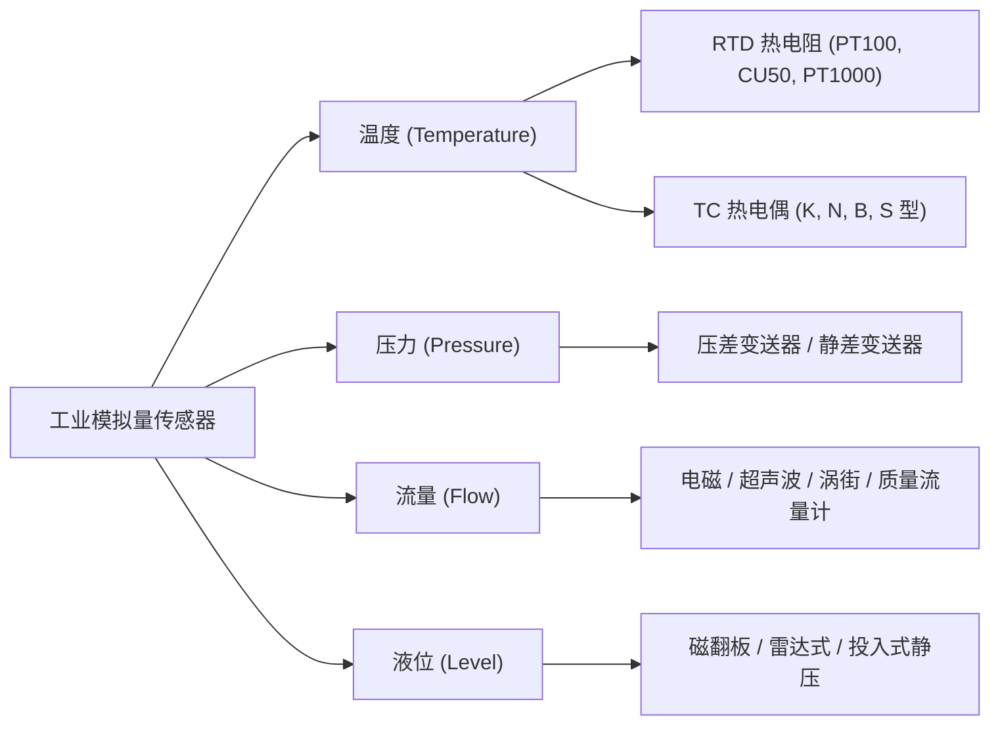
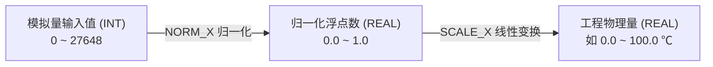

# 模拟量传感器与信号处理

> [!abstract] 核心概览
> 工业现场不仅包含“开/关”两种状态的数字量（Digital），更多的是连续变化的物理量（Analog），如温度、压力、流量、液位等。本章系统讲解工业变送器选型、外围接线（二/三/四线制）、信号调理器件，以及西门子 PLC 中的 A/D 转换、通道标定与组态换算。

---

## 1. 信号基本概念对比

| 信号类型 | 特征描述 | 典型场景 | PLC 数据表现 |
| :--- | :--- | :--- | :--- |
| **数字量（Digital）** | 又称开关量、布尔量、离散量，只有 `0` 或 `1` 两种状态。 | 按钮、行程开关、光电传感器、继电器输出。 | `Bool`（1 位） |
| **模拟量（Analog）** | 连续变化的物理量，反映现实世界的连续参数。 | 温度、压力、流量、液位、转速、阀门开度。 | `Int`（16 位，`0 ~ 27648`）/ `Real`（浮点工程量） |

---

## 2. 工业常用传感器分类与原理



### 2.1 温度检测：RTD 与热电偶
- **RTD 热电阻（PT100 / CU50 / PT1000）**：
  - 基于金属电阻率随温度变化的特性。PT100 在 $0^\circ\text{C}$ 时阻值为 $100\,\Omega$。
  - 测温精度高，常用于 $-200^\circ\text{C} \sim +600^\circ\text{C}$ 中低温段。
- **TC 热电偶（K、N、B、S 型）**：
  - 基于塞贝克效应（Seebeck effect），两种不同金属焊接产生热电势。
  - 测温范围极宽（最高可达 $1600^\circ\text{C}$），常用于高温炉膛、热处理车间。

### 2.2 流量计与数字脉冲输出
- **常用类型**：电磁流量计（导电液体）、超声波流量计（非接触）、涡街流量计（蒸汽/气体）、质量流量计（高精度直接测质量）。
- **复合输出特性**：很多工业流量计除了输出 `4~20mA` 瞬时流量外，还配备**数字量脉冲输出**（例如每累计流过 $1\,\text{m}^3$ 或 $1\,\text{t}$ 输出 1 个脉冲），PLC 可直接用计数器累计总量。

### 2.3 液位变送器
- **磁翻板式**：现场直观显示，可配干簧管变送输出 4~20mA。
- **雷达式 / 超声波**：非接触测量，适用于腐蚀性、粘稠液体。
- **投入式静压变送器**：直接投入液体底部，通过测量液体静压 $P = \rho g h$ 换算出液位深度。

---

## 3. 标准信号与接线规范

### 3.1 工业标准信号体系
- **标准电流信号**：`4~20mA`（抗长距离干扰能力强，电流环路断线时信号降为 0mA，具备天然断线检测功能）。
- **标准电压信号**：`0~10V`（适用于短距离、低干扰的盘内连接，不可长距离传输）。

### 3.2 变送器接线制式区别

| 制式 | 接线根数 | 供电方式 | 信号回路 | 接线特点 |
| :--- | :---: | :--- | :--- | :--- |
| **两线制** | 2 根 | 外部回路供电（通常 DC 24V） | 电源与信号共用两根线 | 传感器串联在 24V 电源回路中，电流在 4~20mA 间变化。 |
| **三线制** | 3 根 | 独立供电（V+、GND） | 信号输出端与 GND 形成回路 | 电源负与信号负共用一根地线。 |
| **四线制** | 4 根 | 独立供电（2 根电源线，可为 AC 220V 或 DC 24V） | 独立的 2 根信号输出线（Signal+、Signal-） | 电源回路与信号输出完全隔离。 |

### 3.3 关键配套硬件选型
1. **信号隔离器**：消除地回路电位差引起的共模干扰，防止强电窜入烧毁 PLC 模块。
2. **信号配电器**：专门为现场两线制变送器提供隔离工作电源，同时采集 4~20mA 信号输送给 PLC。
3. **信号分配器（一分多）**：现场只有一路 4~20mA 传感器信号，需要同时送入 PLC 系统、现场数显仪表和记录仪时使用。

---

## 4. TIA Portal 组态与数值换算

### 4.1 A/D 与 D/A 转换
- **A/D 转换（模数转换）**：外部物理量电流/电压 $\to$ 转换成 PLC 内部的整型数字值（`IW` / `%AI`）。
- **D/A 转换（数模转换）**：PLC 程序输出数值（`QW` / `%AQ`） $\to$ 输出为实际 4~20mA 或 0~10V 控制执行机构（如电动调节阀、变频器频率）。

### 4.2 模块通道组态模式对照

在西门子 S7-1200 / S7-1500 系统中，模拟量通道转换标准量程均为 **`0 ~ 27648`**：

![[Analog_01_TIA_Config.gif]]

| 硬件通道组态 | 实际传感器量程 | 对应 PLC 内部整数值 | 特性与工程建议 |
| :--- | :--- | :---: | :--- |
| **`4..20mA`** | `4 ~ 20mA` | **`0 ~ 27648`** | 正常测量区间；断线或故障时小于 0，便于断线诊断。 |
| **`0..20mA`** | `4 ~ 20mA` | **`5530 ~ 27648`** | 换算推导：$27648 \times \frac{4}{20} = 5529.6 \approx 5530$。通道若测到 0 说明线路断开。 |
| **`0..10V`** | `0 ~ 10V` | **`0 ~ 27648`** | 标准电压量程。 |

### 4.3 标定与转换标准指令：NORM_X 与 SCALE_X

在 TIA Portal 中处理模拟量工程量转换，标准做法是使用 `NORM_X`（规范化）与 `SCALE_X`（缩放）：



#### SCL 实现代码示例

```scl
// 1. 将原始模拟量通道值 (0~27648) 归一化为 0.0 ~ 1.0
#Temp_Norm := NORM_X(MIN := 0, 
                     VALUE := #AnalogRaw_IW, 
                     MAX := 27648);

// 2. 根据温度变送器实际量程 (如 0.0℃ ~ 150.0℃) 放大为物理工程量
#Actual_Temperature := SCALE_X(MIN := 0.0, 
                               VALUE := #Temp_Norm, 
                               MAX := 150.0);
```

---

## 5. 相关笔记与跳转

- [[00_PLC知识库导航 (MOC)|返回知识库导航]]
- [[PID控制原理与工程调参实战|下一篇：PID控制原理与工程调参实战]]
- [[数据类型与内存寻址|上一篇：数据类型与内存寻址]]
