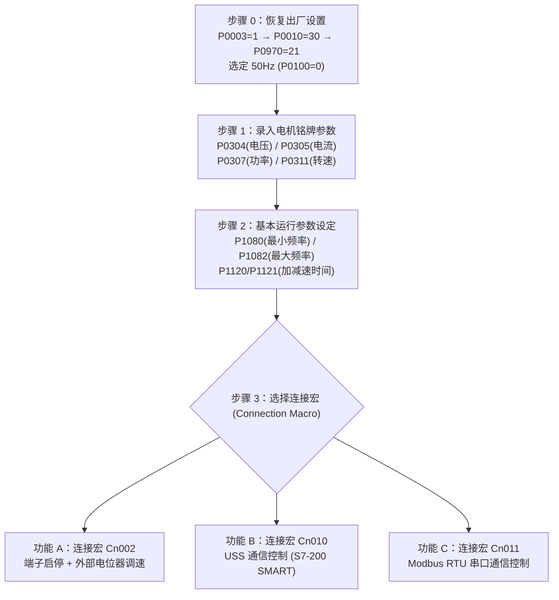
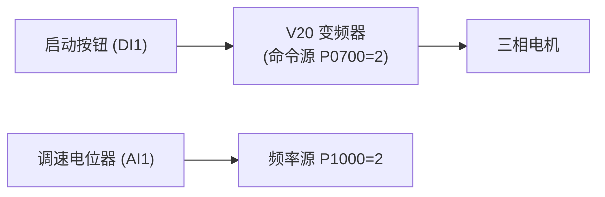

# 变频器工作原理与 V20 调试实操

> [!abstract] 核心概览
> 变频器（Variable Frequency Drive, VFD）是工业传动与电机无级调速的核心执行器件。本篇基于西门子官方手册与工程实训课件，全面拆解变频器主回路与控制回路接线、快速调试标准流程、三大典型连接宏（**Cn002 端子控制、Cn010 USS 总线、Cn011 Modbus RTU 通讯**），并对比台达 MS300 系列参数体系与通讯控制，梳理现场 F72 等经典故障排障秘笈。

---

## 1. 变频器核心原理与拓扑结构

### 1.1 变频调速基本公式
三相交流异步电动机的转速公式为：
$$n = \frac{60 f}{p} (1 - s)$$
- $f$：供电电源频率（Hz）
- $p$：电机磁极对数
- $s$：电动机转差率

> **调速本质**：在极对数 $p$ 固定的情况下，连续平滑地调节定子电源频率 $f$，即可实现电机的无级平滑调速。

### 1.2 交-直-交（AC-DC-AC）拓扑结构

1. **整流回路**：将输入的工频交流电整流为脉动直流电。
2. **中间直流回路**：大容量电解电容滤平脉动电压，储存能量；当电机减速发电回馈时，由**制动单元**驱动**制动电阻**将多余能量释放为热能。
3. **逆变回路**：由 6 只高速大功率绝缘栅双极型晶体管（IGBT）构成，通过高频正弦脉宽调制（SPWM）技术，将直流电逆变为电压和频率均可调的三相交变电流。

---

## 2. 硬件接线与端子布置（以西门子 SINAMICS V20 为例）

![[V20_01_典型系统接线图.png]]

![[V20_02_端子布置图.png]]

### 2.1 主回路接线要点
- **电源输入端子**：三相 $380\text{V}$ 为 `L1、L2、L3`（单相 $220\text{V}$ 为 `L1、N`），必须串接熔断器或断路器，严禁将电源输入接至输出端子！
- **电机输出端子**：`U、V、W` 连接电动机三相绕组。若电机旋转方向相反，只需任意调换两相接线即可。
- **制动电阻端子**：`DC+` 与 `B+` 接制动电阻，用于大惯量快速刹车。
- **保护接地（PE）**：变频器接地必须牢靠，接地电阻 $< 4\,\Omega$。

### 2.2 控制回路端子详解

| 端子标号 | 功能定义 | 说明 |
| :--- | :--- | :--- |
| **`DI1 ~ DI4`** | 数字量输入通道 1~4 | 支持 PNP（高电平有效）或 NPN（低电平有效）接法 |
| **`DIC`** | 数字输入公共端 | **DIC 接 24V 时为 PNP 接法；DIC 接 0V 时为 NPN 接法** |
| **`24V / 0V`** | 变频器辅助供电输出 | 变频器内部隔离输出的 DC 24V 电源，供外部按钮或传感器使用 |
| **`AI1`** | 模拟量输入通道 1 | 可接入外部电位器、0~10V 或 4~20mA 信号（由端子旁 DIP 拨码切换） |
| **`10V / 0V`** | 电位器基准参考电源 | 提供高精度的 10V 基准参考电压，供调速电位器分压 |
| **`DO1+ / DO1-`** | 晶体管数字量输出 | DC 24V 晶体管输出，可用于指示“变频器运行中”或“故障状态” |
| **`DO2 (05/06/07)`** | 继电器输出 | 常开/常闭干触点，额定 AC 250V 2A，常用于连锁停机或声光报警 |
| **`P+ / N-`** | RS485 串行通信接口 | 用于 USS 或 Modbus RTU 通信总线 |

---

## 3. V20 快速调试总流程（必按标准顺序）

### 步骤 0 · 恢复出厂设置与基准频率选择
在面板（BOP）上按 `M` 进入参数菜单：
1. `P0003 = 1`：用户访问级别设为“标准”。
2. `P0010 = 30`：调试参数设为“出厂复位模式”。
3. `P0970 = 21`：执行恢复出厂默认值（显示屏出现 `8.8.8.8` 闪烁，约 60 秒后自动复位完成）。
4. **频率基准选择**：首次上电提示设置 `P0100`，国内电网必须选 **`P0100 = 0`（欧洲 50 Hz，功率单位 kW）**。

### 步骤 1 · 电机铭牌参数录入
严格核对现场电机名牌铭牌值进行填写：
- `P0304[0]`：电机额定电压（V，如星接填 380V，角接填 220V）
- `P0305[0]`：电机额定电流（A）
- `P0307[0]`：电机额定功率（kW）
- `P0308[0]`：电机功率因数 $\cos\varphi$（通常 0.75~0.85）
- `P0310[0]`：电机额定频率（50.00 Hz）
- `P0311[0]`：电机额定转速（RPM，如 1350 或 1420 转/分）

### 步骤 2 · 通用运行参数配置
- `P1080[0]`：最小运行频率，设为 `0.0 Hz`。
- `P1082[0]`：最大运行频率，国内标准设为 `50.0 Hz`。
- `P1120[0]`：斜坡上升时间（加速时间），设为 `10.0 s`（根据负载惯量调整，过短易报 F1 过流）。
- `P1121[0]`：斜坡下降时间（减速时间），设为 `10.0 s`（过短易报 F2 过压）。
- `P1058[0]`：点动频率，设为 `5.0 Hz`。

---

## 4. 三大控制模式与连接宏实战

### 功能 A · 连接宏 Cn002（端子控制 + 外部电位器调速）
适用于最基础的外部按钮启停 + 电位器或 PLC 模拟量模块（0~10V）调速：

#### 核心参数映射表
| 参数 | 参数名称 | Cn002 设定值 | 端子引脚与功能定义 |
| :--- | :--- | :---: | :--- |
| **`P0700[0]`** | 命令源 | **2** | 端子排控制（由 DI 控制） |
| **`P1000[0]`** | 频率设定源 | **2** | 模拟量输入 AI1 给定 |
| **`P0701[0]`** | DI1 功能定义 | **1** | **ON / OFF1（启停信号）** |
| **`P0702[0]`** | DI2 功能定义 | **12** | **反转信号（REV）** |
| **`P0703[0]`** | DI3 功能定义 | **9** | **故障确认与复位（ACK）** |
| **`P0704[0]`** | DI4 功能定义 | **10** | **正向点动（JOG）** |
| **`P0771[0]`** | 模拟输出 AO1 | **21** | 输出当前实际运行频率（0~20mA 对应 0~50Hz） |

---

### 功能 B · 连接宏 Cn010（USS 工业总线通信）
适用于西门子 S7-200 SMART 或 S7-1200 专有 USS 协议库控制：
- **物理接线**：变频器端子 `P+` 接 PLC 串口 `3+`（RS485+），`N-` 接 PLC 串口 `8-`（RS485-）。
- **参数写入**：`P0700=5`（RS485 控制）、`P1000=5`（RS485 给定）、`P2023=1`（协议选 USS）、`P2010=8`（波特率 38400 bps）、`P2011=1`（USS 站地址）。
- **启停逻辑（控制字 STW 与速度 HSW）**：
  - 速度给定：HSW 满量程设定为 **`16384`**（对应 100% 额定转速，即 50Hz；输入 `8192` 对应 25Hz）。
  - 控制字写入顺序：
    1. 写入 `STW = 16#047E`（使能准备）；
    2. 写入 `STW = 16#047F`（启动正转运行）；
    3. 写入 `STW = 16#0C7F`（启动反转运行）；
    4. 停止：写入 `STW = 16#047E`（按斜坡减速停机）。

---

### 功能 C · 连接宏 Cn011（Modbus RTU 串口通信，重点！）
工业现场最通用、兼容所有品牌 PLC 与上位人机界面的总线模式。

#### 1. 快速参数组态
- `P0700[0] = 5`（命令源来自 RS485）
- `P1000[0] = 5`（频率源来自 RS485）
- **`P2023[0] = 2`（启用 Modbus RTU 协议，改后必须断电重启生效！）**
- `P2010[0] = 6`（波特率选 9600 bps）
- `P2021[0] = 1`（Modbus 从站地址 1）
- `P2034 = 2`（偶校验 Even）
- `P2035 = 1`（停止位 1）

> [!danger] 现场致命避坑：F72 故障彻底根除方案
> - **故障现象**：通信刚连接上不久，变频器频繁报出 **`F72`（USS/Modbus 设定值超时故障）** 停机。
> - **原因分析**：V20 默认参数 `P2014 = 100 ms`（要求上位机必须在 100 毫秒内发送下一帧报文，否则即判定通信中断而保护停机）。现场多从站轮询或上位机延迟必然超过 100ms。
> - **解决方法**：
>   1. **手动修改 `P2014 = 0`（完全禁用报文超时监控）**；
>   2. **执行 `P0971 = 1`（将修改后的参数永久保存至 EEPROM）**！

#### 2. Modbus 控制实战：方法一（PZD 寄存器直接映射，推荐）
在西门子手册映射表中，使用 40100 连续寄存器进行高速控制：

| Modbus 寄存器 | 对应内部信号 | 读/写 | 典型赋值 | 功能说明 |
| :---: | :--- | :---: | :---: | :--- |
| **`40100`** | **STW 控制字** | 写 | `1150 (0x047E)` `1151 (0x047F)` | • `0x047E`：预充电与使能就绪 • `0x047F`：正转运行（Bit10=1 允许 PLC 控制） |
| **`40101`** | **HSW 转速给定** | 写 | `8192` | 速度百分比定标：**`16384 = 100% = 50.0Hz`**，`8192` 对应 25.0Hz |
| **`40110`** | **ZSW 状态字** | 读 | — | **Bit2 = 1** 表示变频器运行中；**Bit3 = 1** 表示存在故障 |
| **`40111`** | **HIW 实际频率** | 读 | — | 读回当前实际转速（16384 对应 50Hz） |

#### 3. Modbus 控制实战：方法二（分散单寄存器映射）
若上位系统希望单独按位/功能控制，可直接操作 40001 基础区：
- **`40003`**：基准频率设定（单位 $0.01\%$，写入 `5000` 对应 $50.00\% = 25.0\text{Hz}$）。
- **`40004`**：运行使能位（写入 `1`）。
- **`40006`**：启动命令位（写入 `1` 启动运行，写入 `0` 减速停止）。
- **`40035`**：读取当前运行状态（`1` 为运行，`0` 为停止）。

---

## 5. 台达 MS300 系列变频器参数体系与对比

除西门子外，台达（DELTA）MS300 是工控领域最普及的高性价比矢量型变频器。其参数设计与通讯映射极具代表性：

### 5.1 控制与频率源关键参数
- **`00-20`（频率命令来源）**：
  - `0`：数字操作器面板键盘给定
  - `1`：外部模拟量输入（AVI，0~10V）
  - **`8`：RS485 串行通信给定**
- **`00-21`（运转命令来源）**：
  - `0`：数字操作器面板按键
  - `1`：外部端子控制（FWD / REV）
  - **`2`：RS485 串行通信控制**
- **`01-00`（最大操作频率）**：默认 `50.00 Hz`。
- **`01-12 / 01-13`（第一加速 / 减速时间）**：默认 `10.00 s`。

### 5.2 台达 MS300 Modbus 通信寄存器地址对照

台达变频器采用十六进制 Hex 地址直接映射：

| 通讯地址 (Hex) | 读/写 | 作用定义 | 常用控制数值 |
| :---: | :---: | :--- | :--- |
| **`2000H`** | 写 | **通信控制命令字** | • `0001H`：减速停止 • `0002H`：正转运行（RUN） • `0012H`：反转运行（REV） • `0020H`：正向点动（JOG） |
| **`2001H`** | 写 | **主频率设定（单位 0.01 Hz）** | 写入 `5000` 对应 `50.00 Hz`；写入 `2500` 对应 `25.00 Hz` |
| **`2101H`** | 读 | **驱动器状态字** | 读取当前状态（Bit0: 停止/运行，Bit1: 正转/反转，Bit4: 故障中） |
| **`2103H`** | 读 | **当前输出频率（0.01 Hz）** | 实时反馈电机当前转速 |
| **`2104H`** | 读 | **当前输出电流（0.01 A）** | 实时反馈电机负载电流 |

---

## 6. 变频器常见故障与快速排障表

| 故障代码 (V20) | 故障名称 | 常见诱发原因 | 现场排查与解决对策 |
| :---: | :--- | :--- | :--- |
| **`F1`** | 过电流 (Overcurrent) | • 加速时间 `P1120` 设得太短 • 电机过载或机械卡死 • 输出电缆相间短路或接地 | • 延长加速时间 `P1120` • 检查机械转轴是否顺畅 • 用摇表（兆欧表）测量电机对地绝缘 |
| **`F2`** | 过电压 (Overvoltage) | • 减速时间 `P1121` 设得太短，重力或大惯量倒拖发电 • 电网电压过高 | • 延长减速时间 `P1121` • 加装制动电阻并启用直流制动功能 |
| **`F3`** | 欠电压 (Undervoltage) | • 输入电源缺相或瞬时跌落 • 进线断路器跳闸 | • 测量输入端子 `L1/L2/L3` 实际线电压 |
| **`F4`** | 逆变器过热 | • 散热风道积灰堵塞 • 环境温度超标或散热风扇停转 | • 清理散热片与风道灰尘，更换故障散热风扇 |
| **`F72`** | 通信设定值故障 | • 报文时间间隔超出了 `P2014` 监控时间 • RS485 通信电缆受到强电干扰断开 | • **将 `P2014` 设置为 `0` 并执行 `P0971=1`** • 确认屏蔽双绞线单端接地并加终端电阻 |

---

## 7. 相关笔记与跳转

- [[00_PLC知识库导航 (MOC)|返回知识库导航]]
- [[工业通讯重点与Modbus实战|关联：工业通讯重点与Modbus实战]]
- [[步进与伺服运动控制基础|关联：步进与伺服运动控制基础]]
- [[数据类型与内存寻址|关联：数据类型与内存寻址]]
