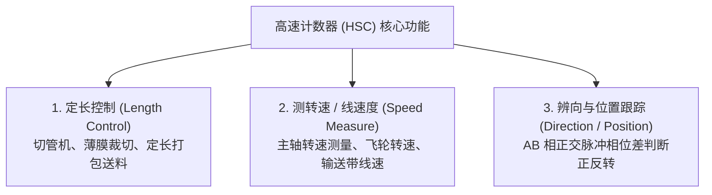
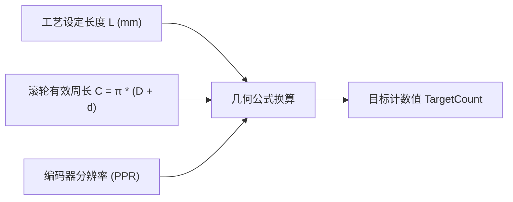

# 增量式编码器与高速计数器 (HSC)

> [!abstract] 核心概览
> 常规 PLC 数字量输入的扫描周期通常在数十毫秒级别，无法捕捉数千赫兹（kHz）的高频光电脉冲。为此，西门子 S7 系列 CPU 内置了硬件级别的**高速计数器（HSC，High Speed Counter）**。本章详细拆解 HSC 的三大核心功能、输入滤波时间严密数学推导、定长输送机构几何标定与程序控制逻辑。

---

## 1. 高速计数器三大典型应用



### 1.1 硬件传感器：增量式编码器
- **线数（Resolution）**：码盘旋转一圈输出的脉冲个数（如 1000 线）。
- **AB 相 4 倍频原理**：A 相与 B 相在物理上错开 $90^\circ$ 电气相位差。PLC 硬件对 A 相和 B 相的上升沿与下降沿全部计数，分辨率可提升 4 倍：
  $$\text{最高分辨率} = 1000 \times 4 = 4000\text{ 计数/圈}$$

---

## 2. 软件核心参数：输入滤波时间严密推导

> [!important] 为什么必须严谨计算滤波时间？
> PLC 输入通道具有数字滤波功能，用于过滤现场线路感应的高频毛刺。**只有当外部信号的电平持续时间大于滤波设定时间时，PLC 硬件才判定为有效脉冲**。若滤波时间设得过大，正常的高频编码器脉冲会被 PLC 当作杂波滤除，导致严重的“严重漏脉冲、尺寸越走越长”现象！

### 2.1 理论推导模型
- 1 秒走 10 圈 $\to$ 10000 个脉冲 $\to$ 单脉冲周期 $0.1\,\text{ms}$。
- 1 秒走 100 圈 $\to$ 100000 个脉冲 $\to$ 单脉冲周期 $0.01\,\text{ms}\,(10\,\mu\text{s})$。

### 2.2 实际机械工程案例实算

已知传动系统硬件参数：
- 驱动电机额定转速：$1350\,\text{RPM}$（圈/分钟）
- 减速机减速比：$1:10$
- 编码器线数：$1000$ 线

**计算步骤**：
1. **求传动轴实际最高输出转速**：
   $$n_{\text{out}} = \frac{1350\,\text{RPM}}{10} = 135\,\text{RPM}$$
2. **换算为秒速度（圈/秒）**：
   $$v_{\text{sec}} = \frac{135}{60} = 2.25\,\text{圈/s}$$
3. **计算脉冲输出频率（Hz）**：
   $$f = 2.25\,\text{圈/s} \times 1000\,\text{脉冲/圈} = 2250\,\text{P/s (Hz)}$$
4. **计算单个完整脉冲的时间周期（$T$）**：
   $$T = \frac{1}{f} = \frac{1}{2250} \approx 0.000444\,\text{s} = 0.444\,\text{ms}$$
5. **计算输入高电平最短持续时间（按标准方波占空比 50% 考量）**：
   $$t_{\text{high}} = \frac{T}{2} = \frac{0.444\,\text{ms}}{2} \approx 0.222\,\text{ms}$$

> [!tip] 滤波时间工程选型结论
> 由于输入高电平最短只有 $0.222\,\text{ms}$，**在 TIA Portal 硬件组态中，该输入通道的“数字量输入滤波时间”必须选择 $\le 0.2\,\text{ms}$（如 $0.2\,\text{ms}$ 或 $0.1\,\text{ms}$）**，方可可靠捕捉全部脉冲。

---

## 3. TIA Portal 中 HSC 组态与数值监控

在硬件设备组态中激活高速计数器，设置计数模式为“计数”、操作模式为“单相”或“A/B相正交四倍频”：

![[HSC_02_TIA_Config.jpg]]

在变量监控表或状态 DB 中读取硬件分配的输入双字地址（如 `%ID1000`）即可实时读取编码器脉冲数值：

![[HSC_01_Value_Display.jpg]]

---

## 4. 实战开发：输送线定长切断数学模型与程序设计

### 4.1 几何换算：设定长度 $\to$ 目标脉冲数

在定长输送线中，编码器安装在传动滚轴上。注意必须计入**输送皮带厚度**对滚轮节圆直径的影响：



#### 物理参数定义：
- 滚轴直径：$D = 32\,\text{mm}$
- 皮带厚度：$d = 2\,\text{mm}$
- 编码器线数：$1000\,\text{PPR}$

#### 换算公式推导：
1. **滚轮有效节圆周长**：
   $$C = \pi \times (D + d) = 3.141593 \times (32 + 2) \approx 106.8\,\text{mm}$$
2. **设定送料长度为 $150\,\text{mm}$ 时的脉冲总数**：
   - 滚轮所需旋转圈数：
     $$N_{\text{rev}} = \frac{150\,\text{mm}}{106.8\,\text{mm}} \approx 1.4045\,\text{圈}$$
   - 所需脉冲数：
     $$\text{TargetPulse} = 1.4045 \times 1000 \approx 1404\text{ 个脉冲}$$
3. **通用数学公式**：
   $$\text{TargetPulse} = \frac{\text{编码器线数} \times \text{设定长度 } L}{\pi \times (D + d)}$$
4. **实际距离公式（由计数值反算实际长度）**：
   - 单个脉冲对应的实际位移（脉冲当量）：
     $$\Delta L = \frac{\pi \times (D + d)}{\text{编码器线数}} = \frac{106.8\,\text{mm}}{1000} \approx 0.1068\,\text{mm/脉冲}$$
   - 任意时刻的实际送料长度：
     $$\text{ActualLength} = \text{CurrentCount} \times \Delta L = \frac{\text{CurrentCount} \times \pi \times (D + d)}{\text{编码器线数}}$$
   - 校验示例：$\text{CurrentCount} = 1404$ 时，$\text{ActualLength} \approx 1404 \times 0.1068 \approx 150.0\,\text{mm}$，与设定长度一致。

> [!note] 四倍频计数的一致性要求
> 若 HSC 组态为“A/B 相正交四倍频”，则公式中的“编码器线数”必须替换为 $4 \times \text{PPR}$（本例 $1000 \times 4 = 4000$ 计数/圈），此时 $\Delta L \approx 0.0267\,\text{mm/计数}$。**换算公式与实际组态必须使用同一分辨率基准**，否则计算出的实际距离会相差 4 倍。

---

## 5. 核心控制接口与 SCL 程序逻辑

在西门子梯形图或 SCL 中，调用 `CTRL_HSC` 指令块，通过修改计数值或重置当前值实现闭环截断：

![[HSC_03_FixedLength_Logic.jpg]]

### 5.1 关键接口参数定义
- `CurrentCount`：高速计数器实时计数值（双整型 `DInt`，映射自 `%ID1000`）。
- `EnHSC`：高速计数功能使能端。
- `EnCV`：写入新计数值触发标志（置 1 时触发修改当前值）。
- `NewCurrentCount`：拟写入的新计数值（通常在切断完成后写入 0 实现计数值复位）。

### 5.2 定长控制切断逻辑代码

```scl
// 1. 根据当前工艺配方中的设定长度 (mm)，实时计算切断脉冲数
#TargetPulses := REAL_TO_DINT((1000.0 * #Recipe_CutLength_mm) / (3.141593 * (#Roller_Dia + #Belt_Thickness)));

// 2. 输送带运行中，比对当前编码器值与目标脉冲数
IF #Conveyor_Running AND ("HSC_CurrentCount" >= #TargetPulses) THEN
    #Conveyor_Running := FALSE;   // 停止送料输送带
    #Cutter_Start := TRUE;        // 触发切刀下行动作
END_IF;

// 3. 切刀切断完成并回位后，复位高速计数器当前值清零
IF #Cutter_AtHome_Signal AND #Cutter_Completed THEN
    #EnCV := TRUE;                // 允许修改当前计数值
    #NewCurrentCount := 0;        // 重置为 0
    #Cutter_Completed := FALSE;
    #Conveyor_Running := TRUE;    // 开启下一循环送料
ELSE
    #EnCV := FALSE;
END_IF;
```

---

## 6. 相关笔记与跳转

- [[00_PLC知识库导航 (MOC)|返回知识库导航]]
- [[步进与伺服运动控制基础|上一篇：步进与伺服运动控制基础]]
- [[工业通讯重点与Modbus实战|下一篇：工业通讯重点与Modbus实战]]
