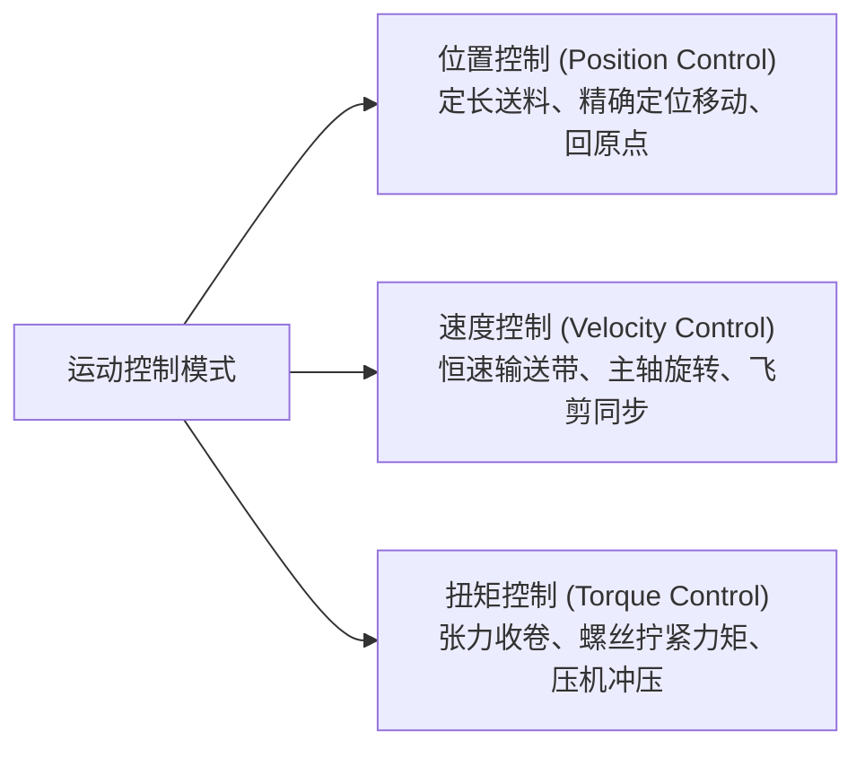
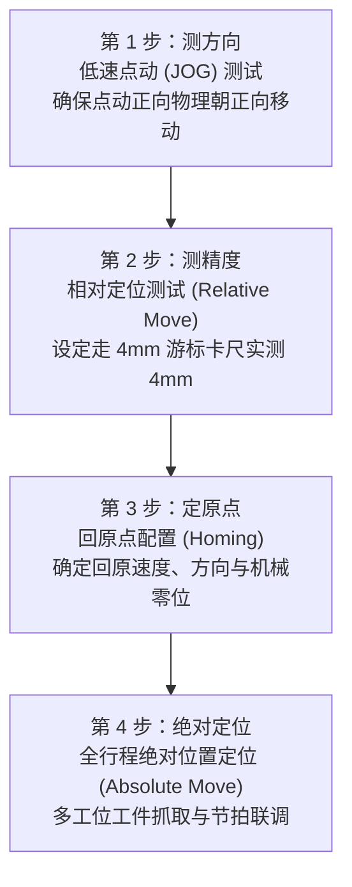

# 步进与伺服运动控制基础

> [!abstract] 核心概览
> 运动控制（离散机械控制）广泛应用于物料搬运、自动包装、精密组装和码垛机构中。实现精准定位的关键在于电机选型、驱动器接线（西门子源型 vs 三菱漏型、限流电阻匹配）、机械传动几何换算，以及严格遵守“测方向 $\to$ 测精度 $\to$ 定原点 $\to$ 绝对定位”的四步标准调试法则。

---

## 1. 运动控制基础要素

### 1.1 常见被控驱动对象
- **步进电机**：开环定位系统，低速大扭矩，成本经济，无累计误差（但存在过载失步风险）。
- **伺服电机**：全闭环/半闭环控制系统，高速平稳、动态响应极快、过载能力强、精度极高。
- **变频器（VFD）**：主要用于交流异步电机的调速与加减速缓冲控制。

### 1.2 三大核心控制模式

---

## 2. 步进驱动器硬件配置与选型

### 2.1 驱动器核心拨码参数
1. **工作电流设定（均值电流 / 峰值电流）**：
   > [!warning] 严重警示：防烧电机
   > 驱动器拨码开关设定的电流值，**绝对不能超过电机铭牌标注的额定电流**！若设定过大，电机会在静止锁轴或运行时瞬间发热并烧毁内部绝缘线圈。
2. **细分参数（Microstep）**：
   - 标准两相步进电机步距角通常为 $1.8^\circ$（转一圈需要 $\frac{360^\circ}{1.8^\circ} = 200$ 个整步脉冲）。
   - 设置 4 细分时：转一圈需要 $200 \times 4 = 800$ 个脉冲；细分越大，电机运转越平滑细腻、低速振动越小。
3. **供电电源类型**：
   - **DC 24V / DC 48V**（开关电源）：现场最常用。
   - **AC 48V**（环形变压器）：瞬态过载大扭矩工况更佳。

---

## 3. 驱动器信号定义与外围接线实战

驱动器核心控制端子包含三对差分光耦接口：
- **PUL（Pulse）**：脉冲信号，控制电机转动步数与速度（频率决定转速，数量决定位移）。
- **DIR（Direction）**：方向信号，高/低电平决定电机正转或反转。
- **ENA（Enable）**：脱机使能信号，输入有效时光耦导通，电机释放锁轴转矩，可用手自由盘动轴体。

![[Motion_01_Stepper_Wiring.jpg]]

### 3.1 工业 PLC 接线制式对比

由于 PLC 输出晶体管极性不同，接法有本质区别：

| PLC 品牌 / 输出类型 | 接线制式 | 具体接法规范 |
| :--- | :--- | :--- |
| **西门子 PLC (PNP 源型)** | **共阴极接法** | • PLC 晶体管输出正信号（DC 24V）。 • PLC 的 `Q0.0 (PUL)` 接驱动器 `PUL+`，`Q0.1 (DIR)` 接 `DIR+`，使能点接 `ENA+`。 • 驱动器端的 **`PUL-`、`DIR-`、`ENA-` 全部短接并并联接入电源公共端 0V（GND）**。 |
| **三菱 / 台达 PLC (NPN 漏型)** | **共阳极接法** | • PLC 晶体管输出负信号（接通 0V）。 • 驱动器端的 **`PUL+`、`DIR+`、`ENA+` 全部短接并并联接入 DC 24V 正极**。 • PLC 输出点分别拉低接驱动器的 `PUL-`、`DIR-`、`ENA-`。 |

### 3.2 差分 5V 接口限流电阻选择
> [!caution] 驱动器光耦防烧电阻计算
> 绝大多数步进/伺服驱动器的内部高速光耦额定工作电压为 **5V**（正向导通电流约 10~15mA）：
> - 当 PLC 控制器输出为 **24V** 时：每个信号端子必须**串联一个 $2\,\text{k}\Omega$（1/4W）金属膜限流电阻**！
> - 当控制器输出为 **12V** 时：必须**串联一个 $1\,\text{k}\Omega$ 限流电阻**！
> - 若漏接限流电阻直接施加 24V，将瞬间击穿烧毁驱动器内部高速光耦元件！

---

## 4. 机械传动关键参数与几何公式

### 4.1 专业术语与计算公式
- **螺距（Pitch）**：丝杆相邻两个螺纹牙之间的轴向距离。
- **丝杆头数（Starts，丝数 $n$）**：丝杆上螺旋线（槽）的条数，单头丝杆 $n=1$，双头丝杆 $n=2$。
- **导程（Lead, $L$）**：电机带动丝杆旋转整整一圈时，螺母沿轴向直线移动的物理距离：
  $$L = \text{螺距} \times \text{丝杆头数}$$
- **圈脉冲（$P_{\text{rev}}$）**：驱动电机使最终负载旋转一整圈所需的脉冲总数：
  $$P_{\text{rev}} = \left(\frac{360^\circ}{\text{步距角}}\right) \times \text{驱动器细分} \times \text{机械减速比 } i$$
  > **实算案例**：步距角 $1.8^\circ$（200步/圈），驱动器 4 细分，配 $1:5$ 减速机：
  > $$P_{\text{rev}} = 200 \times 4 \times 5 = 4000\text{ 个脉冲}$$
- **脉冲当量（Pulse Equivalent, $\delta$）**：PLC 发送单个脉冲时，负载机构移动的微观物理距离：
  $$\delta = \frac{\text{导程 } L}{P_{\text{rev}}} \quad (\text{mm/脉冲})$$

---

## 5. 运动控制四步标准调试法

在完成 TIA Portal 工艺对象（TO_PositioningAxis）轴组态、正负软硬限位配置后，现场严格遵循以下 4 步调试流程：

1. **第 1 步：测方向**
   - **操作**：先在轴调试控制面板中使用**极低速度的点动（JOG）**进行微调。
   - **判定**：按点动正（JOG+），机构向工艺约定的正方向位移；若反向，在轴组态中勾选“反转电机转向”或交换 $A/B$ 相接线，**严防高速冲顶撞机**。
2. **第 2 步：测精度**
   - **操作**：使用相对定位（MC_MoveRelative），指令发送让机构前行指定距离（如 $100.0\,\text{mm}$ 或旋转 $360.0^\circ$）。
   - **判定**：使用百分表或卡尺核对实际距离。若存在偏差，说明“导程”或“每转脉冲数”参数换算有误，需重新校正脉冲当量。
3. **第 3 步：定原点（寻原）**
   - **操作**：测试主动寻原逻辑（MC_Home），轴向原点开关慢速贴近，检测到开关上升沿后反向脱离以寻找编码器零位脉冲（Z 相信号）。
   - **判定**：重复回原 3 次，确认零点绝对坐标能精准复位至 $0.00\,\text{mm}$。
4. **第 4 步：绝对定位**
   - **操作**：根据产线工位坐标，执行绝对定位（MC_MoveAbsolute）。
   - **判定**：检验加减速平滑度（S 曲线加减速）、目标位置到达信号（`Done`）以及轴到位精停稳定性。

---

## 6. 相关笔记与跳转

- [[00_PLC知识库导航 (MOC)|返回知识库导航]]
- [[增量式编码器与高速计数器(HSC)|下一篇：增量式编码器与高速计数器(HSC)]]
- [[PLC程序架构与五步调试法|上一篇：PLC程序架构与五步调试法]]
