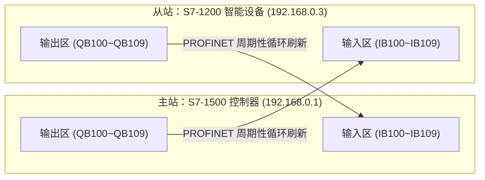
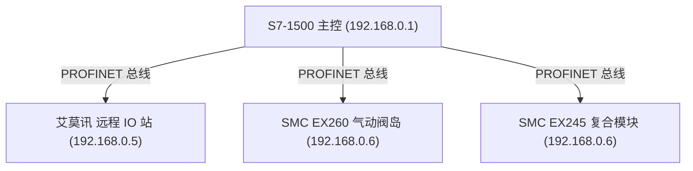

# PROFINET 智能设备与 IO 映射表

> [!abstract] 核心概览
> 在跨 PLC 协同控制及分布式产线中，PROFINET **I-Device（智能设备）**技术能够将下级 PLC（如 S7-1200、S7-200 SMART）作为分布式标准 IO 挂载到主控 PLC（如 S7-1500）下。理解**“主站输入映射从站输出、主站输出映射从站输入”**的镜像机制，以及多品牌远程 IO 站（艾莫讯、SMC 阀岛）的硬件地址分配，是构建大型产线网络的基础。

---

## 1. PROFINET 智能设备 (I-Device) 交互原理

> [!important] 核心交互口诀
> **主站写输出，从站读输入；从站写输出，主站读输入。**  
> 主从双方的输入输出存储区呈现“首尾交错镜像”关系。

---

## 2. PLC 间 I-Device 传输映射对照表

### 2.1 S7-1500 与 S7-1200 对等数据交互

- **主控制器**：S7-1500 (`192.168.0.1`)
- **智能设备**：S7-1200 (`192.168.0.3`)

| 数据流向 | S7-1500 地址 | 信号属性 | S7-1200 地址 | 信号属性 | 传输字节宽度 | 说明 |
| :--- | :---: | :---: | :---: | :---: | :---: | :--- |
| **1200 $\to$ 1500** | `IB100` | 输入 | `QB100` | 输出 | 1 Byte | 状态位/运行标志 |
| | `IB101` | 输入 | `QB101` | 输出 | 1 Byte | 故障代码/报警位 |
| | `IB102 ~ IB109` | 输入 | `QB102 ~ QB109` | 输出 | 8 Bytes | 现场工艺计数值/采集数据 |
| **1500 $\to$ 1200** | `QB100` | 输出 | `IB100` | 输入 | 1 Byte | 主控下发启动/复位指令 |
| | `QB101` | 输出 | `IB101` | 输入 | 1 Byte | 工位使能/急停联锁信号 |
| | `QB102 ~ QB109` | 输出 | `QB102 ~ QB109` | 输入 | 8 Bytes | 下发工艺配方/目标位置 |

---

### 2.2 S7-1500 与 S7-200 SMART 数据交互

- **主控制器**：S7-1500 (`192.168.0.1`)
- **智能设备**：S7-200 SMART (`192.168.0.4`，通过 GSDML 文件挂载)

> [!note] 200 SMART 地址偏移
> S7-200 SMART 在 PROFINET 智能设备模式下，其从站映射地址位于高端地址区（如 `IB1152`、`QB1152` 开始）。

| 数据流向 | S7-1500 控制器地址 | S7-200 SMART 智能设备地址 | 字节长度 | 功能定义 |
| :--- | :---: | :---: | :---: | :--- |
| **200 SMART $\to$ 1500** | `IB200` | `QB1152` | 1 Byte | 200 SMART 现场机构就绪状态 |
| | `IB201` | `QB1153` | 1 Byte | 动作完成信号 / 报警状态 |
| | `IB202 ~ IB209` | `QB1154 ~ QB1161` | 8 Bytes | 传送生产计数与模拟量数据 |
| **1500 $\to$ 200 SMART** | `QB200` | `IB1152` | 1 Byte | 启动/停止/回原点使能 |
| | `QB201` | `IB1153` | 1 Byte | 节拍同步握手信号 |
| | `QB202 ~ QB209` | `IB1154 ~ IB1161` | 8 Bytes | 生产节拍与配方参数下发 |

---

## 3. 分布式 IO 与阀岛硬件地址分配表

现场产线常用的第三方 PROFINET 远程分布式 IO 站（艾莫讯）与气动阀岛（SMC EX260/EX245）：

### 3.1 艾莫讯远程 IO 站（IP: `192.168.0.5`）

| S7-1500 物理地址 | 通道类型 | 现场模块对应端子 | 实际受控设备/传感器类型 |
| :---: | :---: | :---: | :--- |
| **`IB3`** | 数字量输入 (DI) | `DI8`（8 点） | 8 路现场光电开关 / 磁簧原位开关 |
| **`QB4`** | 数字量输出 (DO) | `DO8`（8 点） | 8 路报警指示灯 / 接触器线圈 |
| **`IW4`** | 模拟量输入 (AI) | `AI1` | 模拟量通道 1（0~20mA / 4~20mA） |
| **`IW6`** | 模拟量输入 (AI) | `AI2` | 模拟量通道 2（温度变送器） |
| **`IW8`** | 模拟量输入 (AI) | `AI3` | 模拟量通道 3（压力变送器） |
| **`IW10`** | 模拟量输入 (AI) | `AI4` | 模拟量通道 4（液位变送器） |
| **`IW12`** | 模拟量输入 (AI) | `AI5` | 模拟量通道 5（流量计瞬时流量） |
| **`IW14`** | 模拟量输入 (AI) | `AI6` | 模拟量通道 6（备用变送器） |
| **`QW5`** | 模拟量输出 (AO) | `AO1` | 模拟量输出 1（调节阀开度 0~100%） |
| **`QW7`** | 模拟量输出 (AO) | `AO2` | 模拟量输出 2（变频器给定速度频率） |

---

### 3.2 SMC 气动总线阀岛（IP: `192.168.0.6`）

气动执行机构通过总线阀岛集中控制，极大简化了电磁阀电缆布线：

#### SMC EX260 阀岛
| S7-1500 地址 | 阀岛物理通道 | 作用描述 |
| :---: | :--- | :--- |
| **`QB9`** | 电磁阀线圈 1 ~ 8 | 驱动气缸 1 ~ 4（双电控气缸伸出/缩回） |
| **`QB10`** | 电磁阀线圈 9 ~ 16 | 驱动气缸 5 ~ 8（气动手爪开夹、阻挡气缸升降） |

#### SMC EX245 复合输入/输出阀岛
| S7-1500 地址 | 信号属性 | 通道功能描述 |
| :---: | :---: | :--- |
| **`QB13`** | 输出 | 电磁阀线圈 1 ~ 8 驱动输出 |
| **`QB14`** | 输出 | 电磁阀线圈 9 ~ 16 驱动输出 |
| **`IB16`** | 输入 | 阀岛集成传感输入通道 1 |
| **`IB17`** | 输入 | 阀岛集成传感输入通道 2 |
| **`IB18`** | 输入 | 阀岛集成传感输入通道 3 |
| **`IB19`** | 输入 | 阀岛集成传感输入通道 4 |

---

## 4. 相关笔记与跳转

- [[00_PLC知识库导航 (MOC)|返回知识库导航]]
- [[工业通讯重点与Modbus实战|上一篇：工业通讯重点与Modbus实战]]
- [[触摸屏与上位机通讯联调指南|下一篇：触摸屏与上位机通讯联调指南]]
- [[数据类型与内存寻址|关联：内存寻址与字节排列]]
