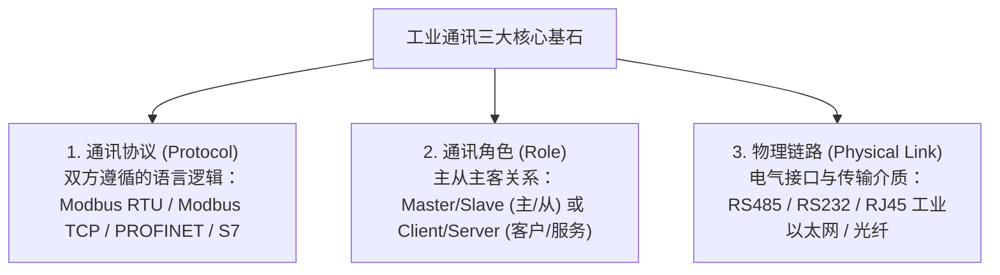
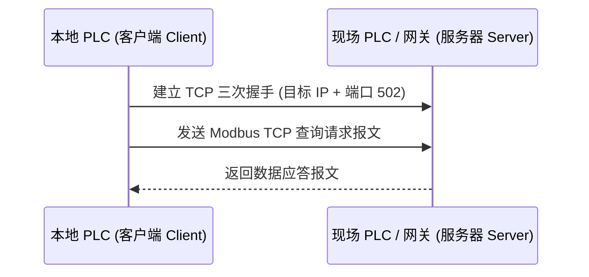

# 工业通讯重点与 Modbus 实战

> [!abstract] 核心概览
> 在工业自动化现场，信息孤岛已被彻底打破，PLC 必须与智能仪表、变频器、伺服驱动器和上位系统协同组网。掌握**通讯三要素（协议、角色、物理链路）**，攻克串口 RS485 / Modbus RTU 极性与接线陷阱，掌握 Modbus 寄存器寻址映射，以及掌握以太网 Modbus TCP 与 PROFINET 的配置要义，是现场电气工程师的核心硬技能。

---

## 1. 工业通讯核心三要素

无论任何通信协议，组网前必须首先明确以下三项基本面：

---

## 2. 串口网络与 Modbus RTU 实战

### 2.1 硬件接口与物理布线规范
- **物理接口**：RS485 差分电平通信，理论最大无中继传输距离可达 **1200 米**。
- **线缆选型**：必须使用**屏蔽双绞线（RVVSP 2×0.5 或 2×0.75）**。
- **拓扑结构**：**必须严格采用“手拉手（Daisy Chain）”菊花链拓扑**，严禁星形分支或树状分支，以消除信号反射。
- **接地与屏蔽**：电缆屏蔽层必须**单端可靠接地**（通常在主站电柜端接地），禁止双端接地以防形成地电位环流。
- **终端电阻**：在总线物理位置的**最首端设备和最末端设备**，两根信号线间并联 **$120\,\Omega$ 终端匹配电阻**，吸收高频反射波。

> [!warning] 经典防坑：西门子 RS485 接口引脚反向定义
> 工业标准与绝大多数第三方仪表定义：**`A` 为正（+），`B` 为负（-）**。  
> **但是西门子 S7-1200 / S7-1500（CB 1241 / CM 1241 / DB9 串口模块）内部定义是反向的！**
> - **西门子端子：`B` 对应 `+`（发送/接收正信号，DB9 针脚 3）**
> - **西门子端子：`A` 对应 `-`（发送/接收负信号，DB9 针脚 8）**
> - **现场接线口诀**：西门子与常规第三方仪表连接时，应 **“西门子 B 接第三方 A/正，西门子 A 接第三方 B/负”**！

### 2.2 通讯参数一致性原则
主从双方通讯必须严格保持 4 参数一致：
1. **波特率**：常用 $9600\,\text{bps}$、$19200\,\text{bps}$、$38400\,\text{bps}$。
2. **数据位**：标准为 8 位。
3. **校验位**：无校验（N，None）、奇校验（O，Odd）、偶校验（E，Even）。
4. **停止位**：通常为 1 位（个别设备偶校验配 1 位，无校验配 2 位）。
5. **从站地址（站号）**：同一 RS485 串行总线网络内，**每个从站的站地址必须全局唯一**（1~247）。

### 2.3 调试工具与排查实操
- **硬件工具**：工业级 USB 转 RS485 转换器。
- **软件工具**：串口调试助手、ModScan32、剑儒 Modbus 仿真工具。
- **指示灯观察**：`TXD`（PLC 发送查询帧，绿灯闪烁）与 `RXD`（从站正常回送应答帧，红灯闪烁）。若仅 TX 闪烁而 RX 灭，说明从站未应答（检查接线正负反接、波特率不匹配或站号错误）。
- **注意事项**：电脑串口助手联调完毕后，必须物理断开与总线的连接，避免总线驱动器冲突。

![[Comm_01_Serial_Debug.jpg]]

---

## 3. Modbus 寄存器四大地址区详解

Modbus 协议划分为四大标准存储区，掌握其编号规则是读写仪表的核心：

| 寄存器区域 | PLC 数据性质 | 访问权限 | 典型应用场景 | Modbus 功能码 |
| :--- | :--- | :---: | :--- | :---: |
| **`00001 ~ 09999`** | 线圈输出（Coils） | **读 / 写** | 远程启动/停止电机、继电器输出吸合 | `01H`(读), `05H`(写单), `0FH`(写多) |
| **`10001 ~ 19999`** | 离散输入（Inputs） | **只读** | 光电开关、常开常闭触点状态、限位反馈 | `02H`(读) |
| **`30001 ~ 39999`** | 输入寄存器（Input Regs） | **只读** | 模拟量采集值（当前温度、瞬时电流） | `04H`(读) |
| **`40001 ~ 49999`** | 保持寄存器（Holding Regs） | **读 / 写** | 参数设定、PID 设定值、变频器频率、报警阈值 | `03H`(读), `06H`(写单), `10H`(写多) |

### 3.1 32位数据拼接案例（电表电量读取）
现场仪表传输电度数或功率常采用 32 位浮点数（占 2 个连续的 16 位保持寄存器）：
- 读取 `40001`（高字）：`32`（`16#0020`）
- 读取 `40002`（低字）：`16586`（`16#40CA`）
- 在 PLC 中将两个字拼接并通过 IEEE 754 转换为 REAL 浮点数，得到实际电压/功率读数：**`21137.38`**。

### 3.2 西门子 V20 变频器 Modbus 控制字写入
通过向 V20 变频器的保持寄存器写入特定十六进制控制字，可直接控制启停：
- **正转运行**：写入 `16#047F`
- **反转运行**：写入 `16#0C7F`
- **减速停止**：写入 `16#047E`

> [!tip] 专项实操指南
> 变频器完整的接线、出厂调试、三大连接宏（Cn002/Cn010/Cn011）以及 F72 超时故障处理，详见专门笔记：[[变频器工作原理与V20调试实操]]。

---

## 4. 以太网 Modbus TCP 通讯

以太网环境下取消了校验和与串口帧间隔判定，将 Modbus 报文直接封装于 TCP/IP 协议包内（端口号固定为 **`502`**）。

- **角色界定**：发起读取请求的一方为 **Client（客户端）**，存储数据并提供响应的一方为 **Server（服务器）**。
- **传输介质**：工业 6 类双绞线（带屏蔽），传输距离 $\le 100\,\text{m}$。若距离超过 $1000\,\text{m}$，需增配**光纤收发器与单模工业光纤**。
- **从站地址说明**：直连独立的 Modbus TCP 从站设备时，Unit ID 通常可填 `0` 或 `255`；若通过 Modbus 网关转接 RS485 子网时，必须准确指定子网仪表实际站地址。

![[Comm_02_ModScan_Test.jpg]]

![[Comm_03_Network_Topology.jpg]]

---

## 5. PROFINET (PN) 工业以太网

PROFINET 是西门子主流的实时以太网协议，具备极高的确定性与微秒级响应能力：
- **通信角色**：
  - **IO 控制器（IO Controller）**：通常为 S7-1500 / S7-1200 主 PLC。
  - **IO 设备（IO Device）**：分布式远程 IO 站（ET200）、伺服驱动器（SINAMICS V90）、智能仪表。
- **设备识别机制**：
  - **设备名称（Device Name）**：PROFINET 寻址的第一要素！出厂设备未分配名称时无法建立通讯。
  - **IP 地址**：分配在同一子网内。
  - 组网准则：**同一物理网络内，设备名称必须唯一，IP 地址必须唯一**。
- **线缆标识**：西门子 PROFINET 工业网线外部绝缘皮为**标准绿色**（区别于 PROFIBUS DP 的紫色电缆）。

---

## 6. 相关笔记与跳转

- [[00_PLC知识库导航 (MOC)|返回知识库导航]]
- [[PROFINET智能设备与IO映射表|下一篇：PROFINET智能设备与IO映射表]]
- [[触摸屏与上位机通讯联调指南|关联：触摸屏与上位机通讯联调指南]]
- [[增量式编码器与高速计数器(HSC)|上一篇：增量式编码器与高速计数器(HSC)]]
