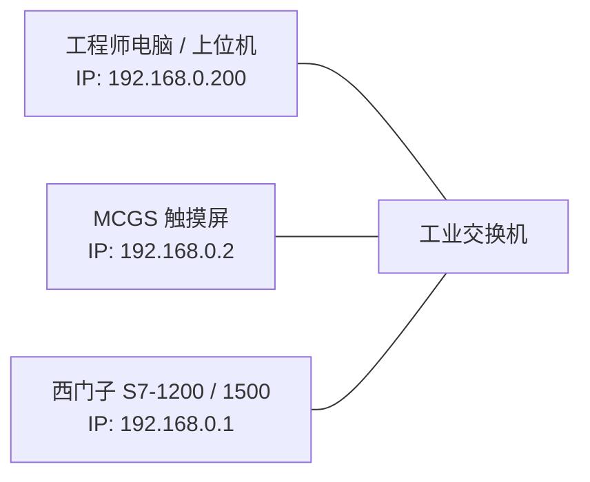

# 触摸屏与上位机通讯联调指南

> [!abstract] 核心概览
> 在上位人机界面（HMI，如昆仑通态 MCGS、西门子精智屏）或电脑上位机与 PLC 建立通讯时，“物理网线已插好但画面全带问号、通讯不上”是一线工程师最常遇到的故障。本指南梳理网络规划、TIA Portal 侧关键防坑选项、PG/PC 访问点配置，以及博途与 Factory I/O 虚拟仿真联合调试全流程。

---

## 1. 硬件层与网络三要素确认

### 1.1 物理层检查三步法
1. **指示灯检查**：观察网口 `Link`（绿色常亮，物理链路导通）与 `Act`（黄色闪烁，有数据收发数据包）。
2. **同网段不同 IP 原则**：
   - 子网掩码必须一致（如 `255.255.255.0`）。
   - IP 地址必须处于同一网段且全局唯一（例如均为 `192.168.0.X`），严禁 IP 冲突。
3. **PING 命令底层诊断**：
   - 打开 Windows 控制台，执行 `ping 192.168.0.1`。
   - 若能收到 `TTL` 应答且丢包率为 0%，证明硬件与 TCP/IP 协议栈完全正常。

---

## 2. 博途 (TIA Portal) 侧关键安全与访问设置

> [!warning] 致命陷阱：物理通了但数据读不出的两大元凶
> 1. **未勾选 PUT/GET 访问**：西门子出于网络安全策略，默认禁用外部设备直接读写。
> 2. **DB 块使用了“优化的块访问”**：第三方触摸屏通过绝对地址（如 `DB1.DBX0.0`、`DB1.DBD4`）寻址，优化的 DB 块无物理偏移地址，触摸屏无法解析。

### 2.1 必须配置的 2 个关键步骤
1. **勾选 PUT/GET 通信访问**：
   - 在项目树中双击进入 `CPU 属性` $\to$ `保护与安全（Protection & Security）` $\to$ `连接机制（Connection mechanisms）`。
   - **务必勾选：“允许来自远程对象的 PUT/GET 通信访问”**。
   - **重要**：更改后，**必须对 PLC 执行“下载硬件组态”**，仅下载软件代码不生效！
2. **关闭数据块的优化的块访问**：
   - 右键目标 DB 块 $\to$ `属性` $\to$ `属性标签页` $\to$ **取消勾选“优化的块访问”**。
   - 重新编译 DB 块，确保变量显示出具体的偏移量（Offset：`0.0`、`2.0`、`4.0` 等）。

---

## 3. 触摸屏侧（MCGS）工程通讯参数配置

在 MCGS 组态软件中添加“通用 TCP/IP 父设备”与“西门子 S7-1200/1500 驱动”：

| 参数项 | 配置规范 | 说明 |
| :--- | :--- | :--- |
| **本地 IP 地址** | 填写触摸屏自身的 IP（如 `192.168.0.2`） | 必须与 PLC 在同一子网 |
| **远程 IP 地址** | 填写目标 PLC 的 IP（如 `192.168.0.1`） | 通讯目标指向 |
| **远程端口号** | **`102`** | 西门子 S7 专有通信标准端口 |
| **机架号 / 插槽号** | 机架号 `0`，插槽号 `1`（S7-1200）/ `2`（S7-300） | 物理 CPU 所在卡槽 |
| **通讯角色** | **客户端 (Client)** | 触摸屏作为客户端主动发起轮询读写请求 |

---

## 4. PC 端 PG/PC 接口设置

在电脑上位机（如 WinCC、KepServerEx 或上位 C#/Python 软件）与 PLC 通讯前，必须在 Windows 控制面板中正确指定驱动访问点：

![[HMI_01_PG_PC_Interface.jpg]]

- **控制面板路径**：`控制面板` $\to$ `设置 PG/PC 接口 (Set PG/PC Interface)`。
- **应用程序访问点选择**：
  - **`S7ONLINE`**：用于 TIA Portal 博途、S7-1200、S7-1500、WinCC 等上位系统，将其绑定至当前实际连接的物理以太网卡（或虚拟网卡）。
  - **`MWSMART`**：用于 S7-200 SMART 系列专有通讯驱动。

---

## 5. 虚拟联合仿真：博途 + PLCSIM + Factory I/O (IO工厂)

在没有实物硬件的情况下，可搭建虚实联动仿真环境进行整线动作调试：

![[HMI_02_FactoryIO_Sim.jpg]]

### 5.1 联调配置要点
1. **启动 S7-PLCSIM**：在博途中点击“启动仿真”，将程序下载到虚拟 CPU 中并置于 `RUN` 状态。
2. **配置 Factory I/O 驱动**：
   - 打开 Factory I/O $\to$ `File` $\to$ `Drivers` $\to$ 选择驱动为 **`Siemens S7-PLCSIM`**。
   - 点击 `Configuration` $\to$ 选择模型为 `S7-1200` 或 `S7-1500`。
   - 将 3D 场景中的传感器拖拽映射到 `I` 点（如 `I0.0`、`I0.1`），电动机/传送带/分流器映射到 `Q` 点（如 `Q0.0`、`Q0.1`）。
3. **闭环联调**：在 Factory I/O 中按下启动按钮，博途梯形图/SCL 即刻响应，3D 仿真环境中的货物流水线实时运行，真正做到“零成本验证整套控制流程”！

---

## 6. 相关笔记与跳转

- [[00_PLC知识库导航 (MOC)|返回知识库导航]]
- [[工业通讯重点与Modbus实战|上一篇：工业通讯重点与Modbus实战]]
- [[PROFINET智能设备与IO映射表|关联：PROFINET智能设备与IO映射表]]
- [[PLC程序架构与五步调试法|关联：五步调试法与现场交互]]
